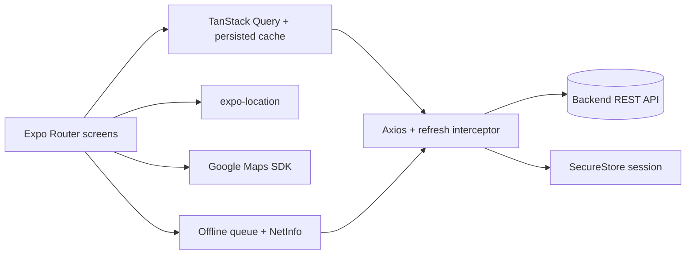

# udv-plantio-mobile

Offline-capable mobile app (Expo / React Native) for registering plantings on a map with GPS, backed by a separate REST API.

Status: working client built for a private organization; not published as an open product. No automated tests.

## What it does

- Sign-in with access/refresh tokens stored in SecureStore, with automatic refresh (`src/lib/session.ts`, `src/lib/api.ts`).
- Map view of plants (`react-native-maps`) and a plant list with fuzzy search.
- Add plants with GPS location, photos and form validation.
- Offline queue and persisted query cache that survive restarts (`src/context/offline-context.tsx`, `src/lib/cache.ts`).
- Notifications and battery/network aware behavior.

## Architecture



- `app/`: file-based routes (`public/` sign-in, `authenticated/` tabs and add-plant flow).
- `src/http/generated/`: Orval-generated client from the backend OpenAPI spec.
- `docs/superpowers/plans/`: design plan for the offline-first behavior.

## Key decisions

- Requests have a 15 s timeout so weak-signal calls return to the offline queue instead of hanging (`src/lib/api.ts`).
- Maps API key is read from the environment at build time in `app.config.js`; none is committed.
- API client is generated, not hand-written (`orval.config.ts`).

## Tech stack

Expo 53, React Native, Expo Router, NativeWind, TanStack Query (+ async-storage persister), Axios, Orval, Zod, React Hook Form.

## Getting started

Prerequisites: Node 20+, Android Studio or Xcode, a Google Maps API key restricted to your app id.

```bash
npm install
cp .env.example .env
npx expo prebuild
npm run android   # or: npm run ios
```

| Variable | Purpose |
| --- | --- |
| `EXPO_PUBLIC_BACKEND` | Base URL of the backend API |
| `GOOGLE_MAPS_API_KEY` | Google Maps SDK key (build time) |
| `VITE_HTTP_API_URL` | Backend URL used by `npm run orval` to fetch the OpenAPI spec |
| `EXPO_PUBLIC_R2_PUBLIC_URL` | Public base URL for uploaded images |
| `MODE` | Environment mode flag |

Regenerate the API client with `npm run orval`.

## Testing

No automated tests; lint with `npm run lint`.

## License

All rights reserved. Source available for portfolio review.
