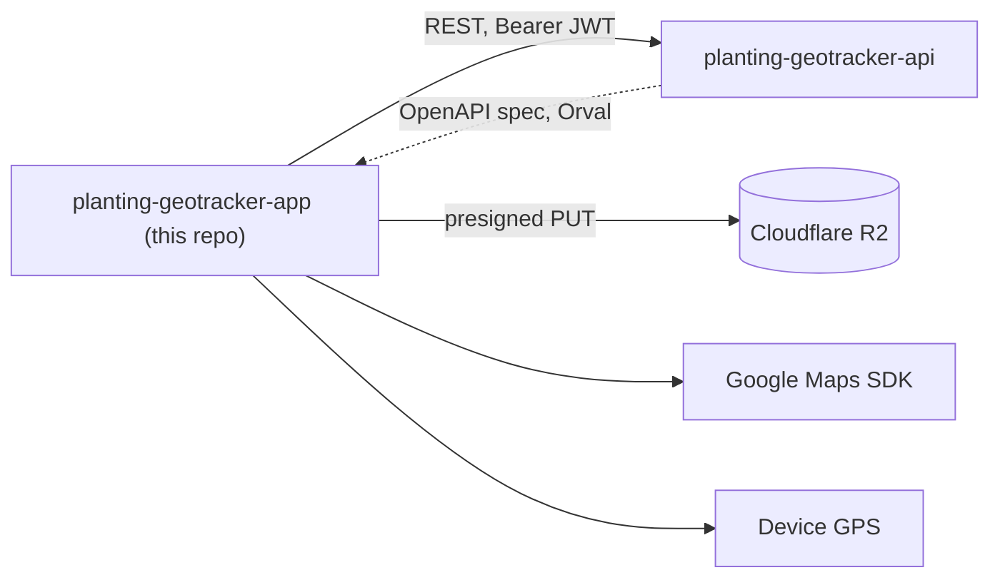
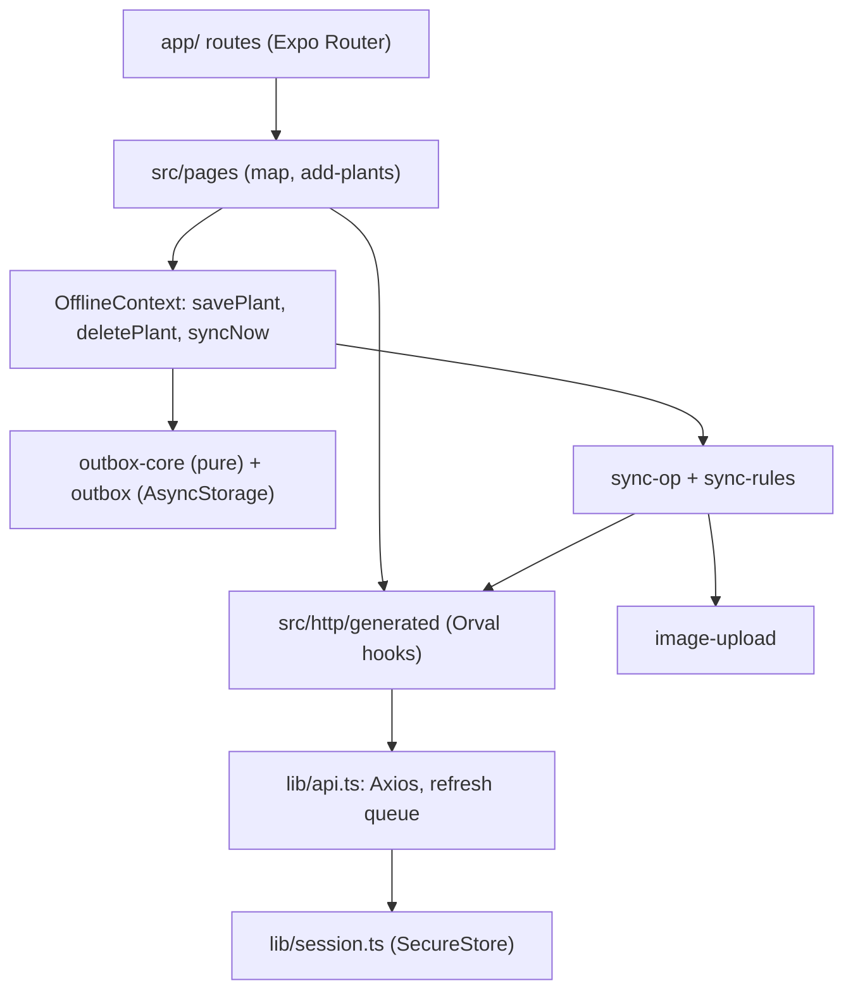
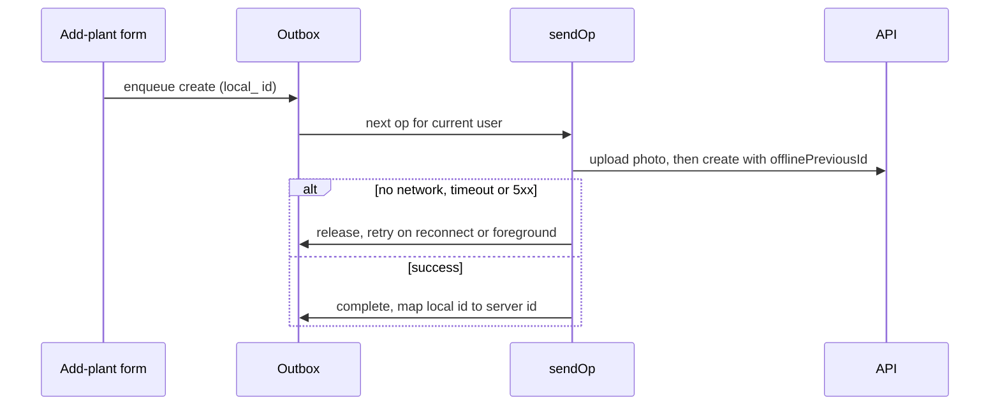

# Planting Geotracker App

Offline-first Expo / React Native app for field teams to register plantings on a map with averaged GPS coordinates and photos, synced to a REST API.

Status: working client built for a private organisation; not published as an open product. Not verified against a production backend from this repository.

## What it does

- Sign-in with access and refresh tokens in SecureStore; a network failure never logs the user out (`src/lib/session.ts`, `src/lib/api.ts`).
- Map of plants with clustering, filters and a details sheet (`src/pages/plants-map/`), plus a searchable list (Fuse.js).
- Add or edit a plant with GPS position averaged over 5 samples, a photo and a Zod-validated form (`src/pages/add-plants/hooks/use-gps-capture.ts`, `src/utils/gps.ts`).
- Offline outbox: create, update and delete operations are queued on the device, compacted, and sent in order when the connection returns (`src/lib/plants/`).
- Pending and failed sync counters, with retry and discard per operation.
- Persisted query cache so the last known plants load without a connection (`src/lib/react-query.ts`).
- Photos upload straight to object storage through presigned URLs (`src/lib/plants/image-upload.ts`).

## Architecture







- `app/` holds routes only (`public/` sign-in, `authenticated/` tabs and add-plant); logic lives in `src/`.
- The server list and the outbox are merged for display, so a queued plant appears immediately (`applyOutbox` in `src/lib/plants/outbox-core.ts`).
- The API contract is the only coupling to the backend; the client in `src/http/generated/` is produced by Orval.

## Key engineering decisions

- Pure outbox logic separated from React Native so it can be checked in Node: compaction of create+update+delete, dependent ops, per-user ownership (`src/lib/plants/outbox-core.ts`, `outbox-core.check.ts`).
- Retries are safe because creates carry `offlinePreviousId`, which the API upserts on (`src/lib/plants/sync-op.ts`).
- Error classification decides retry, re-login or permanent failure: no response or 5xx releases the op, 401 pauses until login, 404 discards or fails (`src/lib/plants/sync-rules.ts`).
- One sync loop at a time, so reconnect, foreground and boot triggers cannot send the same plant twice (`singleFlight`).
- 15 s request timeout so a weak signal returns the op to the queue instead of hanging (`src/lib/api.ts`).
- Single-flight token refresh queue in the Axios interceptor (`src/lib/api.ts`).
- Maps key is injected at build time from the environment (`app.config.js`).

## Tech stack

Expo 53, React Native 0.79, Expo Router, NativeWind, TanStack Query with async-storage persister, Axios, Orval, React Hook Form, Zod, react-native-maps, expo-location.

## Getting started

Prerequisites: Node 20+, Android Studio or Xcode, a Google Maps key restricted to your app id, a running backend ([planting-geotracker-api](https://github.com/mkwitko/planting-geotracker-api)).

```bash
npm install
cp .env.example .env
npm run orval        # generates src/http/generated from the backend OpenAPI spec
npx expo prebuild
npm run android      # or: npm run ios
```

| Variable | Purpose |
| --- | --- |
| `EXPO_PUBLIC_BACKEND` | Base URL of the backend API |
| `VITE_HTTP_API_URL` | Backend URL read by `orval.config.ts` for the OpenAPI spec |
| `GOOGLE_MAPS_API_KEY` | Google Maps SDK key (build time) |
| `EXPO_PUBLIC_R2_PUBLIC_URL` | Public base URL for uploaded images |
| `MODE` | Environment mode flag |

## Testing

No test runner. Two Node self-check scripts cover the sync core and both pass: `npx tsx src/lib/plants/outbox-core.check.ts` and `npx tsx src/lib/plants/sync-rules.check.ts`. `npm run lint` is available. `npx tsc --noEmit` currently reports 6 errors (two missing UI primitive packages and one missing field in `plant-convertion.ts`).

## Project structure

```text
app/         Expo Router routes (public, authenticated tabs, add-plants)
src/pages/   Screen logic: plants-map, add-plants
src/lib/     API client, session, outbox and sync
src/context/ Auth, offline and notification providers
src/http/    Orval-generated client
docs/        Offline-first spec and plan
```

## Related repositories

- [planting-geotracker-api](https://github.com/mkwitko/planting-geotracker-api): Fastify API consumed by this app.

## License

All rights reserved. Source available for portfolio review.
